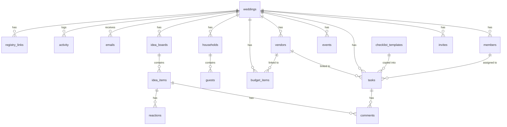

# Data model (draft for review)

Owner: Caleb (Role B). Kai and Carter: please review and leave comments or open an issue.
Building has already started; changes after review go in new migrations, so nothing is locked in.

Source of truth is the SQL in `supabase/migrations/`; generated types are in `lib/db/types.ts`.
App code reads and writes through the functions in `lib/db/`, never with ad-hoc queries.

## Tables



Every table except `checklist_templates` has `id uuid`, `wedding_id`, `created_at` and `updated_at`.

| Table | Main fields |
|---|---|
| `weddings` | `partner1_name`, `partner2_name`, `wedding_date`, `budget_total`, `guest_count_estimate`, `email_slug` (unique; inbox address is `<email_slug>@<INBOUND_EMAIL_DOMAIN>`) |
| `members` | `user_id`, `role` (`couple` / `planner` / `helper`), `display_name`. One row per person per wedding |
| `invites` | `token` (uuid, goes in the link), `role`, `expires_at` (default 14 days). Reusable until it expires or is deleted |
| `tasks` | `title`, `notes`, `category`, `due_date`, `months_before`, `status` (`todo` / `in_progress` / `done` / `booked`), `assignee_id` (a member), `vendor_id`, `completed_at`, `template_id` |
| `events` | `title`, `description`, `starts_at`, `ends_at`, `all_day`, `location` |
| `vendors` | `name`, `type`, `contact_name`, `phone`, `email`, `website`, `status` (`considering` / `contacted` / `booked` / `declined`), `notes` |
| `budget_items` | `category`, `description`, `estimated`, `actual`, `paid`, `due_date`, `vendor_id` |
| `households` | `name` (as written on the envelope), address fields, `side` (`partner1` / `partner2` / `both`), `notes` |
| `guests` | `household_id`, `first_name`, `last_name`, `email`, `phone`, `rsvp` (`pending` / `attending` / `declined`), `meal_choice`, `plus_one_allowed`, `is_child` |
| `idea_boards` | `title`, `category` |
| `idea_items` | `board_id`, `photo_path` (in the `idea-photos` bucket), `caption`, `link_url` |
| `comments` | `body`, `author_id`, and exactly one of `task_id` / `idea_item_id` |
| `reactions` | `idea_item_id`, `user_id`, `emoji` (default 👍) |
| `emails` | `from_address`, `from_name`, `to_address`, `subject`, `body_text`, `body_html`, `received_at`, `provider_message_id`, `attachments` (json list of storage paths), `is_read`, links to a task / vendor / budget item |
| `activity` | `actor_id`, `action` (`created` / `updated` / `completed` / `deleted`), `entity_type`, `entity_id`, `summary`. Written by database triggers |
| `registry_links` | `store_name`, `url`, `notes` |
| `checklist_templates` | `title`, `category`, `months_before`, `sort_order`. Shared by all weddings, read-only |

Design decisions this follows (from `docs/PLAN.md`):
- Tasks, the calendar and "already planned" share one model. "Already planned" = tasks with status `done` or `booked`.
  The calendar merges tasks with a `due_date`, `events`, and `budget_items` with a `due_date` (`getCalendarItems`).
- Guests always belong to a household, because invitations go to addresses.
- AI never writes directly; accepted suggestions go through the normal `lib/db/` functions.

## Who can do what (Row Level Security)

| | couple | planner | helper | not a member |
|---|---|---|---|---|
| See everything in the wedding | yes | yes | yes | no |
| Add / edit / delete anything | yes | yes | no | no |
| Update tasks assigned to them | yes | yes | status and notes only | no |
| Comment and react | yes | yes | yes | no |
| Create invites | yes | yes | no | no |
| Change member roles, remove members, delete the wedding | yes | no | no | no |

- Creating a wedding: `create_wedding()` makes the wedding, adds the creator as `couple` and copies the checklist template
  into `tasks`, with due dates counted back from the wedding date.
- Joining: `get_invite()` shows who invited you (works before logging in); `accept_invite()` adds you as a member.
- `emails` are inserted by Carter's webhook with the service-role key (bypasses RLS). Members can read them,
  couple/planner can link them to items or mark them read.

## Storage buckets (private)

| Bucket | Path | Read | Write |
|---|---|---|---|
| `idea-photos` | `<wedding_id>/<file>` | members | couple / planner |
| `email-attachments` | `<wedding_id>/<file>` | members | service role only (webhook) |

## Realtime

`tasks`, `comments` and `activity` broadcast changes; use `subscribeToWedding()` from `lib/db/realtime.ts`.

## Using `lib/db/`

Every function takes a Supabase client as its first argument, so the same function works in Server Components,
Server Actions, Route Handlers and Client Components:

```ts
import { createClient } from "@/lib/db/supabase/server"; // or "@/lib/db/supabase/browser" in client components
import { getTasks } from "@/lib/db/tasks";

const supabase = await createClient();
const tasks = await getTasks(supabase, weddingId, { status: ["todo", "in_progress"] });
```

Functions throw on error. The service-role client (`@/lib/db/supabase/admin`) is server-only and bypasses RLS:
only webhooks and AI routes may use it.

## Demo data

`npm run db:seed` creates a demo wedding with three logins (password `demo-password-123`):
`couple@demo.wedding`, `planner@demo.wedding`, `helper@demo.wedding`. `npm run db:seed -- --reset` wipes and recreates it.
`npm run test:db` then signs in as each role and checks the permissions above against the dev project.
